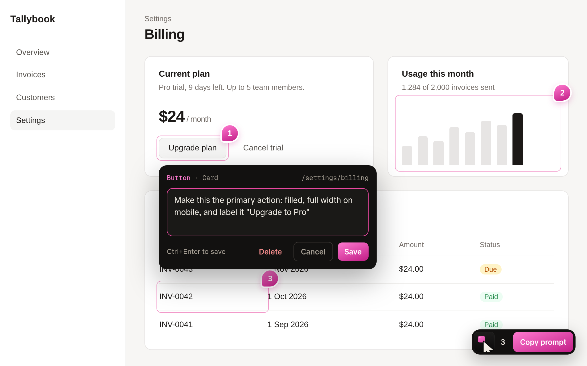

# Pinprompt

Pinprompt is a Chrome extension for any locally running React app. Comment on parts of the page the way you comment in Figma, then copy one short Markdown prompt for your AI tool or a teammate.



Get it from [pinprompt.hizkiajuan.com](https://pinprompt.hizkiajuan.com), or build it from source (below).

## What it does

- Comment in place: click an element or drag over a region, and a comment box opens right there; up to 10 pins per tab
- One session per tab, across the routes of a single-page app
- React component path (development builds, React 16 and later) and likely shadcn/ui components (`data-slot`, Tailwind v3 and v4 class recipes)
- Numbered pins stay on their elements; a small bubble holds the count, Copy prompt and the list
- A compact prompt: shared context once, then one line per element and one per change (about 250 characters a pin)
- Runs only on origins you allow; nothing leaves the browser unless you copy or download it

## Repository layout

- `packages/core`: session rules, prompt and export building, React tree and shadcn inference
- `packages/extension`: the Chrome MV3 extension (service worker, in-page UI in a shadow root, options page)
- `packages/site`: the landing page at pinprompt.hizkiajuan.com, a Cloudflare Worker serving static assets
- `packages/kit`: build and font helpers
- `docs/store`: Chrome Web Store copy and privacy policy; `PUBLISHING.md` has the steps

## Set up

Everything installs from public npm; the build and font helpers live in `packages/kit`.

```bash
bun install
bun run build        # bundles to packages/extension/build, copies the Allo fonts
```

Then in Chrome: `chrome://extensions`, turn on **Developer mode**, **Load unpacked**, pick `packages/extension`. Reload the extension there after each build.

## Use it

1. Run your app, for example on `http://localhost:3000` (allowed by default). The Pinprompt bubble sits in the bottom-right corner; drag it to any corner.
2. Press **Ctrl+Shift+P** (**⇧⌘P** on a Mac) (or click the toolbar button). Comment mode turns on: hovering outlines an element and names its React component, and clicks never reach the app. On the page, **C** toggles comment mode too.
3. Click an element, or drag over a region of at least 12 x 12 px. A numbered pin drops on it and a comment box opens. Write what should change and press **Ctrl+Enter** (**Cmd+Enter** on a Mac). **Esc** cancels.
4. Pins stay on their elements. Hover one to read it, click it to edit or delete. Pins on other routes of the app wait until you go back there.
5. **Copy prompt** in the bubble copies everything as one prompt. Click the bubble for the list, **Download .md** and **Clear**.

Chrome only lets the extension take a pin's screenshot after the toolbar button or the shortcut, and a full page reload takes that away. Pins are kept; use the shortcut once after a reload and screenshots work again.

### Allowed origins

Open the extension's options (the sliders icon in the list, or the toolbar button on a page that isn't allowed yet). `localhost` and `127.0.0.1` (any port, http or https) work right away; add each exact origin you use. Any other host, such as a dev server on your LAN or tailnet, makes Chrome ask for access to that host when you add it. Removing the last origin on a host gives that access back.

### Filenames

```txt
pinprompt-<route-slug>-1-pin-<YYYYMMDD-HHmmss>.md
pinprompt-<route-slug>-<n>-pins-<YYYYMMDD-HHmmss>.md
pinprompt-multi-route-<n>-pins-<YYYYMMDD-HHmmss>.md
```

## Development

```bash
bun run check        # oxlint, bun fmt --check, bun check (types)
bun test
bun run build:ci     # check, test and build, as CI runs it
bun run package      # dist/pinprompt-<version>.zip for the Chrome Web Store
```

The UI uses the **Allo** type system from `packages/kit`: the options page imports `@pinprompt/kit/fonts/allo.css`, and the in-page UI registers the Allo and mono faces under private family names (fonts can't be declared inside a shadow root), loaded through web-accessible dynamic URLs. `build.ts` copies the font files into `packages/extension/fonts/`. `build/` and `fonts/` are generated and not committed. The icon source is `packages/extension/icons/icon.svg`; the PNGs are rendered from it with `rsvg-convert -w N -h N icon.svg -o icon-N.png`.

## Deployment

The landing page deploys through Cloudflare Workers Builds: a push to `main` runs `bun run build:ci`, builds `packages/site` and deploys it (`packages/site/wrangler.jsonc`); other branches get a preview URL. The extension ships to Chrome users as the zip from `bun run package` (see `PUBLISHING.md`).

## Contributing

Bug reports and pull requests are welcome; read [CONTRIBUTING.md](CONTRIBUTING.md) first. Security problems go through [SECURITY.md](SECURITY.md), not issues.

## Licence

[MIT](LICENSE). Made by Juan and contributors. The bundled fonts are under the SIL Open Font License (see `packages/kit/src/fonts/files`).

